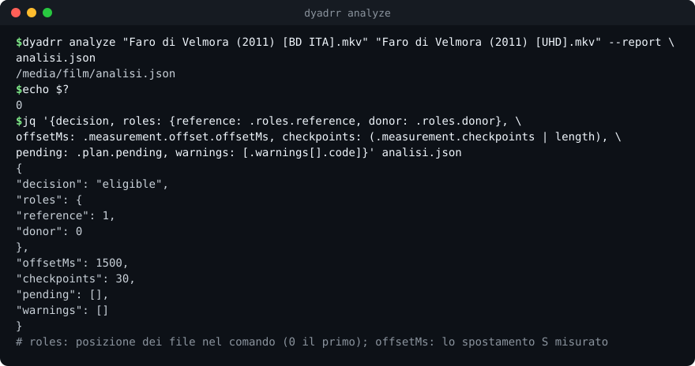
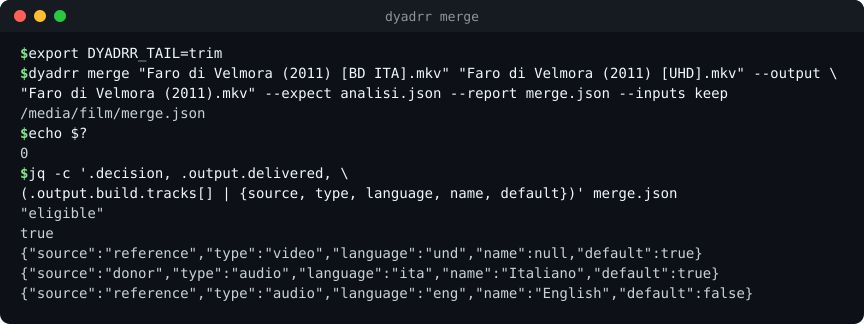
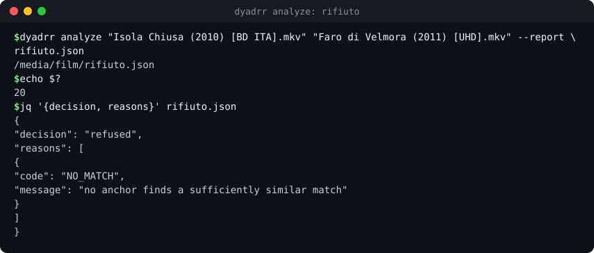

# Dyadrr

[](https://github.com/TehMaat/dyadrr/actions/workflows/ci.yml)
[](https://github.com/TehMaat/dyadrr/actions/workflows/image.yml)
[](https://github.com/TehMaat/dyadrr/releases)
[](docs/INSTALLAZIONE.md#docker)
[](docs/INSTALLAZIONE.md#requisiti)
[](LICENSE)
[](#full-vibe-coded)

Unisce due rip dello **stesso film nella stessa versione** in un unico MKV:
il video, i capitoli e le tracce del rip migliore, più l'audio e i sottotitoli
italiani dell'altro, sincronizzati. **Niente viene ricodificato**: si spostano
solo i pacchetti, con mkvmerge.

Il nome viene da *diade*: due elementi che formano una coppia.

> **Full Vibe Coded.** Codice, test e documentazione di Dyadrr sono scritti
> con un assistente AI, sotto la guida e la revisione del maintainer
> ([dettagli](#full-vibe-coded)).

> **Stato:** fase 1 chiusa nella 0.17.0, su 25 coppie reali e senza merge
> sbagliati ([riassunto](docs/fase1/summary.md)); in corso la fase 2,
> l'integrazione in Wayfinderr spenta di default (servizio nel Compose e file
> job dalla 0.19.0 di Wayfinderr). La riga di comando funziona dalla 0.9.0,
> l'immagine Docker per Wayfinderr dalla 0.12.0
> ([docs/CONTAINER.md](docs/CONTAINER.md)). Le soglie sono quelle della
> taratura 5, in parte ancora provvisorie ([docs/TARATURA.md](docs/TARATURA.md)),
> da rivedere una alla volta con `dyadrr-pairs` ([docs/COPPIE.md](docs/COPPIE.md)).
> Le modifiche sono nel [CHANGELOG](docs/CHANGELOG.md).

## Indice

- [Come funziona](#come-funziona)
- [Avvio rapido](#avvio-rapido)
- [Installazione](#installazione)
- [Uso](#uso)
- [Variabili d'ambiente](#variabili-dambiente)
- [Codici di uscita](#codici-di-uscita)
- [Documentazione](#documentazione)
- [Full Vibe Coded](#full-vibe-coded)
- [Versioni e licenza](#versioni-e-licenza)

## Come funziona

<picture>
  <source media="(prefers-color-scheme: dark)" srcset="docs/img/diagrams/flusso-dark.svg">
  
</picture>

1. **Ruoli.** Il file con l'audio italiano è il **donatore**, l'altro il
   **riferimento** (di norma il video migliore). Li decide Dyadrr.
2. **Misura.** La sincronia si misura confrontando la stessa lingua nei due
   file (di norma l'inglese, o la lingua originale del film). Il risultato è
   un solo spostamento per tutto il film, verificato in decine di punti.
3. **Controlli.** Se lo spostamento cambia a metà film (montaggio o master
   diversi), se le velocità sono diverse o se qualcosa non torna, la coppia
   si rifiuta con un codice preciso.
4. **Merge.** Le tracce italiane vengono spostate e tagliate solo all'inizio
   o alla fine, unite al riferimento e verificate prima di consegnare il file.

Le fasi dell'analisi, con i rifiuti di ciascuna, sono in
[docs/CODICI.md](docs/CODICI.md#dove-nasce-un-rifiuto); tutti i dettagli nello
[studio di fattibilità](docs/STUDIO-DI-FATTIBILITA.md). Le parole del progetto
(donatore, riferimento, S, ancore…) sono nel [glossario](docs/GLOSSARIO.md).

## Avvio rapido

Con Docker non serve installare altro. Due rip nella stessa cartella, per
esempio `/media/film`:

```bash
docker run --rm -v /media/film:/data/film ghcr.io/tehmaat/dyadrr \
  dyadrr analyze "film/Faro di Velmora (2011) [BD ITA].mkv" "film/Faro di Velmora (2011) [UHD].mkv" \
  --report film/analisi.json
```

Uscita 0: la coppia è idonea, e il report dice lo spostamento e le scelte
ancora da fare. Poi il merge, con l'analisi appena confermata:

```bash
docker run --rm -v /media/film:/data/film ghcr.io/tehmaat/dyadrr \
  dyadrr merge "film/Faro di Velmora (2011) [BD ITA].mkv" "film/Faro di Velmora (2011) [UHD].mkv" \
  --output "film/Faro di Velmora (2011).mkv" --expect film/analisi.json --report film/merge.json
```





Una coppia che non va unita si rifiuta, con un codice e uscita 20:



Le schermate sono generate da `npm run docs:screens` con i veri `dyadrr` e
`dyadrr-pairs` su film sintetici con nomi inventati; la CI controlla che siano
aggiornate.

## Installazione

Tre modi, descritti per intero in [docs/INSTALLAZIONE.md](docs/INSTALLAZIONE.md):

| Metodo | Per chi | Comando |
|---|---|---|
| [Docker](docs/INSTALLAZIONE.md#docker) | Chi vuole solo usarlo: Node, ffmpeg e mkvtoolnix sono già dentro | `docker pull ghcr.io/tehmaat/dyadrr` |
| [Docker Compose con Wayfinderr](docs/INSTALLAZIONE.md#docker-compose-con-wayfinderr) | Chi usa Wayfinderr: il runner dei file job | servizio `dyadrr` nel Compose |
| [Da sorgente](docs/INSTALLAZIONE.md#da-sorgente) | Chi sviluppa, o non usa Docker | `npm ci && npm run build && npm link` |

**Requisiti** (da sorgente): Node 22, mkvtoolnix almeno v57, ffmpeg almeno 6.1
con ffprobe. ffmpeg serve per l'analisi; nel merge solo per leggere i punti di
taglio e per la coda delle tracce FLAC, sempre senza ricodificare. Nessuna
scheda grafica: il video non viene mai decodificato.

## Uso

```
dyadrr analyze <a.mkv> <b.mkv> [--original-language <codice>] [--report <file>]
dyadrr merge   <a.mkv> <b.mkv> --output <file> [--expect <report>] [scelte]
```

- `analyze` misura e controlla, e scrive solo il report JSON.
- `merge` fa l'analisi, scrive il file finale e lo verifica; il file compare
  solo se le verifiche passano.
- `--original-language` indica la lingua originale del film (`ENG`, `jpn`,
  `fr`…): serve a scegliere la lingua con cui misurare.
- `--expect <report>` fa eseguire al merge esattamente il piano di un'analisi
  confermata; `--progress json` scrive l'avanzamento su stderr.
- `--inputs keep|delete` dice cosa fare dei due rip dopo un merge riuscito;
  senza, in un terminale si chiede, altrimenti si tengono.
- Su stdout c'è solo il percorso del report; la decisione sta nel report
  ([docs/REPORT.md](docs/REPORT.md)) e nel codice di uscita.

<picture>
  <source media="(prefers-color-scheme: dark)" srcset="docs/img/diagrams/merge-dark.svg">
  
</picture>

Il riferimento completo è in [docs/CLI.md](docs/CLI.md); il report in
[docs/REPORT.md](docs/REPORT.md); rifiuti, errori e codici di uscita in
[docs/CODICI.md](docs/CODICI.md). Per misurare molte coppie insieme c'è
`dyadrr-pairs` ([docs/COPPIE.md](docs/COPPIE.md)).

## Variabili d'ambiente

Alcuni comportamenti li decide chi usa Dyadrr: con un'opzione, oppure
preimpostati con una variabile d'ambiente; altrimenti si scelgono al momento
del merge. Una scelta si chiede solo se serve per quella coppia. L'opzione
vince sulla variabile; una variabile vuota vale come non impostata.

| Variabile | Opzione | Valori | Cosa decide |
|---|---|---|---|
| `DYADRR_TAIL` | `--tail` | `trim`, `keep` | Eccesso italiano in coda, oltre la fine del video |
| `DYADRR_ITALIAN` | `--italian` | `all`, `main` | Tracce audio italiane da prendere |
| `DYADRR_REFERENCE_ITALIAN_SUBS` | `--reference-italian-subs` | `keep`, `drop` | PGS italiani già nel riferimento |
| `DYADRR_EDGE_MISMATCH` | `--edge-mismatch` | `drop`, `keep` | Audio italiano su intro o code diverse |
| `DYADRR_INPUTS` | `--inputs` | `keep`, `delete` | I due rip dopo un merge riuscito e verificato |

Esempio, per non farsi chiedere niente nel merge:

```bash
export DYADRR_TAIL=trim DYADRR_ITALIAN=all DYADRR_REFERENCE_ITALIAN_SUBS=keep DYADRR_EDGE_MISMATCH=drop DYADRR_INPUTS=keep
```

L'effetto di ogni valore è in [docs/CLI.md](docs/CLI.md#scelte). Le variabili
del Compose (immagine, cartelle) sono in
[docs/INSTALLAZIONE.md](docs/INSTALLAZIONE.md#variabili-del-compose). Le
soglie della misura non sono variabili: stanno nel file di taratura
versionato ([docs/TARATURA.md](docs/TARATURA.md)).

## Codici di uscita

| Codice | Esito |
|---|---|
| 0 | Idoneo (`analyze`) oppure merge completato e verificato |
| 20 | Rifiutato: la coppia non va unita |
| 30 | Errore negli ingressi, nell'ambiente o nei parametri |
| 40 | Errore interno, merge fallito o verifica fallita |
| 50 | Annullato |

Ogni codice di rifiuto, errore e avviso è in [docs/CODICI.md](docs/CODICI.md);
i casi più frequenti e cosa fare sono nelle [FAQ](docs/FAQ.md).

## Documentazione

Tutta la documentazione è in [docs/](docs/README.md), con un indice per chi la
legge (chi usa Dyadrr, chi lo integra, chi contribuisce), ed è tenuta allineata
al codice a ogni PR: `npm test` fallisce se codici, scelte, variabili, taratura,
report, moduli, link, immagini o diagrammi non corrispondono.

I titoli dei film negli esempi e nei risultati delle prove sono **inventati**
([docs/README.md](docs/README.md#nomi)).

## Full Vibe Coded

Dyadrr è un progetto **Full Vibe Coded**: il codice, i test e la
documentazione sono scritti con un assistente AI, guidato e rivisto dal
maintainer. Per chi lo usa o contribuisce significa:

- le decisioni non stanno nel codice ma nello
  [studio di fattibilità](docs/STUDIO-DI-FATTIBILITA.md), che si aggiorna
  prima del codice;
- la rete di sicurezza sono `npm test` (con file MKV veri e i controlli sulla
  documentazione) e le verifiche sul file finale prima di consegnarlo;
- la regola che non cambia mai: **nessuna ricodifica** (premessa P1).

Anche i contributi seguono le stesse regole ([CONTRIBUTING.md](CONTRIBUTING.md)).

## Versioni e licenza

[Semantic versioning](https://semver.org): ogni PR verso `main` alza la
versione e la descrive nel [CHANGELOG](docs/CHANGELOG.md); al merge viene
creata la release `vX.Y.Z` e pubblicata l'immagine Docker. Le regole sono in
[CONTRIBUTING.md](CONTRIBUTING.md#versioning).

[MIT](LICENSE)
