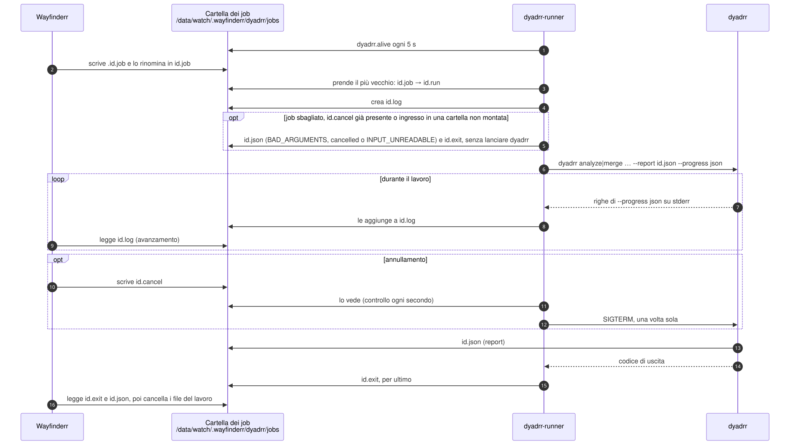

# Container

> **Stato:** implementato dalla 0.12.0 (studio §14.1–14.2). Il lato
> Wayfinderr (servizio nel Compose, volumi, scrittura dei job) c'è dalla
> 0.19.0 di Wayfinderr (TehMaat/wayfinderr#48); i file trattenuti,
> l'abbinamento, l'analisi e il merge vengono dopo (studio §15, fase 2).

In Wayfinderr Dyadrr gira in un container separato, con un'immagine propria
costruita in questo repo. Wayfinderr gli passa i lavori con file job su una
cartella condivisa; il **runner** nel container li prende uno alla volta e
lancia la [riga di comando](CLI.md). Il contratto resta il
[report](REPORT.md).

## Immagine

`ghcr.io/tehmaat/dyadrr`, per amd64 e arm64.

| Tag | Cosa è |
|---|---|
| `latest` | L'ultimo commit di `main` |
| `sha-<7 caratteri>` | Un commit di `main` |
| `<versione>` (per esempio `0.12.0`) | La versione di `package.json` |

| Componente | Versione | Da dove |
|---|---|---|
| Alpine | 3.22 | `alpine:3.22` |
| Node | 22 | pacchetto `nodejs` |
| ffmpeg e ffprobe | 6.1.2 | pacchetto `ffmpeg` |
| mkvtoolnix | 92.0 | pacchetto `mkvtoolnix` |
| tini | 0.19 | pacchetto `tini`, come `ENTRYPOINT` |

Perché proprio queste versioni è nello studio (§14.2): in breve, ffmpeg 6.1 è
quella con cui è provato il metodo di lettura dell'audio.

- **Comando di default:** `dyadrr-runner` (sotto). `dyadrr` è nel `PATH`:
  `docker run --rm -v /film:/data/watch ghcr.io/tehmaat/dyadrr dyadrr analyze watch/a.mkv watch/b.mkv --report watch/a.json`
  (la cartella di lavoro è `/data`).
- **Init:** tini inoltra i segnali al runner: `docker stop` ferma il runner
  in modo pulito, e `init: true` non serve.
- **Utente:** root, salvo `user:` nel Compose (sotto).
- **Coppie reali:** `dyadrr-pairs` è nel `PATH`, per misurare le coppie della
  fase 1 con le versioni dell'immagine ([COPPIE.md](COPPIE.md)).

Il workflow **Image** (`.github/workflows/image.yml`) a ogni PR e a ogni push
su `main` costruisce l'immagine per le due architetture, ripete tutta la suite
(`npm test`) dentro l'immagine amd64, controlla le versioni di Node, ffmpeg e
mkvmerge su entrambe, fa girare un job vero con il runner e `docker stop` e un
elenco di una coppia con `dyadrr-pairs`; su `main` pubblica i tre tag. In locale:

```bash
docker build --target runtime -t dyadrr .     # l'immagine
docker build --target test -t dyadrr:test . && docker run --rm dyadrr:test   # la suite sull'immagine
```

## Cartelle

| Nel container | Cosa è | Montata |
|---|---|---|
| `/data` | Cartella di lavoro: ogni cartella condivisa con Wayfinderr è una sua sottocartella, con un nome | — |
| `/data/watch` | La cartella sorvegliata di Wayfinderr (`MAKEMKV_OUTPUT_DIR`): ingressi trattenuti, file finale, temporanei `.dyadrr/`, job. Obbligatoria e in scrittura: senza, o in sola lettura, il runner non parte | in scrittura |
| `/data/<nome>` | Altre cartelle con ingressi possibili, per esempio i download (`downloads`) o i film in seeding (`seeding`) | di norma in sola lettura |
| `/data/watch/.wayfinderr/dyadrr/jobs/` | La cartella dei job; il runner la crea se manca | — |

I percorsi nel job sono **relativi a `/data`**, con `/`, e cominciano con il
nome della cartella montata: `watch/Film (2).mkv`, `downloads/Film/Film.mkv`.
Assoluti, vuoti o con un elemento vuoto, `.` o `..` sono `BAD_ARGUMENTS`.
Il report riporta i percorsi del container (`/data/watch/…`).

**Cartella non montata.** Se il primo elemento di un ingresso non è una
cartella sotto `/data` (per esempio `seeding/…` senza il mount di
`/data/seeding`), il runner non lancia Dyadrr e scrive lui il report:
`INPUT_UNREADABLE`, uscita 30, con il messaggio

```
/data/seeding/Film/Film.mkv: seeding is not mounted in this container (/data/seeding)
```

Lo stesso testo va nella riga `exit code` del [log del runner](#log-del-runner).
Con la cartella montata e il file mancante decide Dyadrr (`cannot be read
(ENOENT)`). La [FAQ](FAQ.md) dice come aggiungere il mount.

## File della cartella dei job

| File | Chi lo scrive | Cosa contiene |
|---|---|---|
| `<id>.job` | Wayfinderr, con un nome che inizia con un punto e poi rinominato | Il lavoro (sotto) |
| `<id>.run` | Il runner, rinominando il `.job` | Il lavoro preso |
| `<id>.log` | Il runner, da subito | Lo stderr di Dyadrr man mano: le righe di `--progress json` ([REPORT.md](REPORT.md#avanzamento)); un messaggio non JSON solo se Dyadrr non scrive un report |
| `<id>.json` | Dyadrr, o il runner se Dyadrr non lo scrive | Il report |
| `<id>.exit` | Il runner, per ultimo | Il codice di uscita ([CODICI.md](CODICI.md#codici-di-uscita)) e un a capo |
| `<id>.cancel` | Wayfinderr | Ferma il lavoro: Dyadrr riceve SIGTERM, una volta sola. Il contenuto non conta |
| `dyadrr.alive` | Il runner, all'avvio e ogni 5 s | I secondi dall'epoch e un a capo. Più vecchio di 30 s: container spento |
| `dyadrr.runner.jsonl` | Il runner, man mano | Il [log del runner](#log-del-runner), in JSON Lines |
| `dyadrr.runner.1.jsonl` | Il runner, alla rotazione | Il log precedente, oltre 1 MiB |

`<id>`: da 1 a 64 tra lettere ASCII, cifre, `-` e `_`, che comincia con una
lettera o una cifra, mai riusato (un UUID va bene). Un `.job` con un nome
diverso si ignora; uno con un id già usato non si prende. Il runner non
cancella mai i file di un lavoro: li cancella Wayfinderr dopo aver letto
`.exit`. **Quando c'è `.exit`, c'è anche `.json`.**

## Il file job

Una riga `chiave=valore` per riga, in UTF-8: la chiave è quello che precede il
primo `=`, il valore tutto il resto, spazi compresi. Righe vuote ignorate, un
CR in fondo alla riga tolto.

```
command=merge
input=watch/Film (2).mkv
input=downloads/Film/Film.mkv
output=watch/Film (2001).mkv
expect=watch/.wayfinderr/dyadrr/jobs/3f2a….json
original-language=eng
tail=trim
italian=main
reference-italian-subs=drop
edge-mismatch=drop
inputs=keep
```

| Chiave | Valore | Opzione |
|---|---|---|
| `command` | `analyze` o `merge`, obbligatoria | il comando |
| `input` | un percorso; due righe | i due file |
| `output` | un percorso | `--output` |
| `temp-dir` | un percorso | `--temp-dir` |
| `expect` | un percorso | `--expect` |
| `original-language` | un codice di lingua | `--original-language` |
| `tail`, `italian`, `reference-italian-subs`, `edge-mismatch` | un valore della scelta | le [scelte](CLI.md#scelte) |
| `inputs` | `keep` o `delete` | `--inputs` |

Il runner lancia, nella cartella `/data`:

```
dyadrr <command> <input> <input> --<chiave>=<valore>… --report=<jobs>/<id>.json --progress=json
```

Sono `BAD_ARGUMENTS` decisi dal runner, con un report che scrive lui e senza
lanciare Dyadrr: una riga senza `=`, una chiave sconosciuta (anche `report` e
`progress`, che decide il runner), una chiave ripetuta salvo `input`, `command`
mancante o diverso da `analyze` e `merge`, un percorso non valido. Il resto lo
controlla la riga di comando.

## Un lavoro

<picture>
  <source media="(prefers-color-scheme: dark)" srcset="img/diagrams/wayfinderr-dark.svg">
  
</picture>

1. Il runner guarda la cartella ogni secondo e prende un `.job` alla volta,
   dal più vecchio (data di modifica, poi nome), rinominandolo in `.run`.
2. Crea `<id>.log`. Se c'è già `<id>.cancel`, chiude il lavoro come
   annullato senza lanciare Dyadrr; se un ingresso è in una cartella non
   montata, come `INPUT_UNREADABLE` (sopra).
3. Lancia Dyadrr; lo stderr va in `<id>.log`. Un `<id>.cancel`, controllato
   ogni secondo, gli manda SIGTERM: report `cancelled`, uscita 50.
4. Alla fine, se Dyadrr non ha scritto il report, lo scrive il runner con il
   solo esito: `INTERRUPTED` se Dyadrr è stato ucciso da un segnale,
   `INTERNAL` altrimenti. Poi scrive `<id>.exit`.

Un report scritto dal runner ha la forma di sempre, con `mode` e
`arguments.files` se il job li dice e tutto il resto `null` o vuoto.

**Container fermato** (`docker stop`): con un lavoro in corso, il runner manda
SIGTERM a Dyadrr, aspetta il report `cancelled`, scrive `.exit` ed esce.

**All'avvio**, un `.run` senza `.exit` è un lavoro interrotto di colpo
(SIGKILL, memoria esaurita, corrente). Non si rilancia: `.exit` si ricava dal
report se c'è, altrimenti il runner scrive un report `INTERRUPTED` (uscita
40, riprovabile).

## Log del runner

Le righe del runner vanno su stderr, per `docker logs`, e anche in
`dyadrr.runner.jsonl` nella cartella dei job (studio §14.1). Wayfinderr le
raccoglie nel suo storico dei log, con la sua retention
(TehMaat/wayfinderr#54): il runner tiene solo l'ultimo MiB o poco più.

Una riga JSON per evento, con l'a capo:

```json
{"time":"2026-11-06T14:03:12.481Z","level":"warn","msg":"exit code 20","job":"3f2a…","code":"NO_MATCH","version":"0.23.0"}
```

Un avvio e un lavoro con un ingresso in una cartella non montata, su stderr:

```
dyadrr-runner: dyadrr 0.26.0, jobs in /data/watch/.wayfinderr/dyadrr/jobs
dyadrr-runner: mounted: watch (rw), downloads (ro)
dyadrr-runner: 3f2a…: merge "watch/Film (2).mkv" "seeding/Film/Film.mkv"
dyadrr-runner: 3f2a…: exit code 30: /data/seeding/Film/Film.mkv: seeding is not mounted in this container (/data/seeding)
```

| Campo | Cosa contiene |
|---|---|
| `time` | Ora in UTC, ISO 8601 con i millisecondi |
| `level` | `info`, `warn` o `error` |
| `msg` | Il testo di stderr, in inglese, senza `dyadrr-runner:` e senza l'id |
| `job` | L'id del lavoro, solo per le righe di un lavoro |
| `code` | Il codice del report, quando c'è ([CODICI.md](CODICI.md)) |
| `version` | La versione di Dyadrr |

| Riga (`msg`) | `level` |
|---|---|
| `dyadrr <versione>, jobs in <cartella>` (avvio) | `info` |
| `mounted: <cartella> (rw\|ro), …` (avvio): le cartelle sotto `/data`, la sorvegliata per prima e poi per nome; `mounted: none` se non ce n'è | `info` |
| `<command> "<ingresso>" "<ingresso>"` (lavoro preso): `analyze` o `merge` e gli ingressi come nel job, tra virgolette (JSON) | `info` |
| `exit code 0` | `info` |
| `exit code <n>` con `n` diverso da 0, con `code`; per un errore (`decision` `error`) `exit code <n>: <messaggio>`, con la prima riga del messaggio del report | `warn` |
| `not taken: the id was already used` | `warn` |
| `interrupted, closed with exit code <n>` (all'avvio), con `code` | `warn` |
| `<segnale>: stopping`, `stopped` | `info` |
| `dyadrr.alive cannot be written: <errore>` | `error` |
| `error: <messaggio>` (il runner si ferma) | `error` |

- **Lettura:** le righe si aggiungono in fondo, intere. Una riga senza a capo
  in fondo al file è ancora in scrittura: si salta e si rilegge dopo.
- **Rotazione:** se le righe nuove porterebbero il file oltre 1 MiB, prima il
  file si rinomina in `dyadrr.runner.1.jsonl` (al posto del precedente) e si
  ricomincia da un file nuovo. Chi legge per offset, trovando il file più
  corto dell'ultimo offset, finisce prima `dyadrr.runner.1.jsonl`.
- **Errori:** un file che non si scrive (disco pieno, permessi) non ferma il
  runner né un lavoro. Le righe di quel momento vanno solo su stderr, con
  `dyadrr-runner: dyadrr.runner.jsonl cannot be written: <errore>` una volta
  sola, finché il file non torna scrivibile.
- **Senza cartella sorvegliata**, o con la cartella in sola lettura, il
  runner non parte (`error: /data/watch is missing: …` o `… is not writable:
  mount the watched folder read-write`) e le righe vanno solo su stderr: la
  cartella dei job non si scrive.

## Nel Compose di Wayfinderr

```yaml
  dyadrr:
    image: ghcr.io/tehmaat/dyadrr:${DYADRR_TAG:-latest}
    profiles: ["merge"]
    hostname: dyadrr            # fisso: gli avanzi di un lavoro interrotto si eliminano al successivo
    stop_grace_period: 30s
    restart: unless-stopped
    volumes:
      - ${MAKEMKV_OUTPUT_DIR:-./makemkv-output}:/data/watch
      - ${DOWNLOADS_DIR:-./downloads}:/data/downloads:ro
      - ${SEEDING_DIR:-./seeding}:/data/seeding:ro
```

Ogni cartella da cui Wayfinderr può passare un ingresso va montata con lo
stesso nome che usa nel job (`seeding` per i film in seeding,
TehMaat/wayfinderr#86); la riga `mounted:` all'avvio dice quali ci sono.

- **`hostname` fisso:** Dyadrr riconosce i propri temporanei dal nome host
  ([CLI.md](CLI.md#annullamento)); con il nome casuale che Docker dà a ogni
  container, quelli di un container precedente resterebbero.
- **Utente:** lo stesso del backend, così i file scritti da uno si possono
  cancellare dall'altro. Il backend di Wayfinderr gira come root, come
  l'immagine, quindi `user:` non serve; con un backend che gira con un altro
  utente, si aggiunge `user:` con quello.
- **Un solo runner** per cartella dei job.
