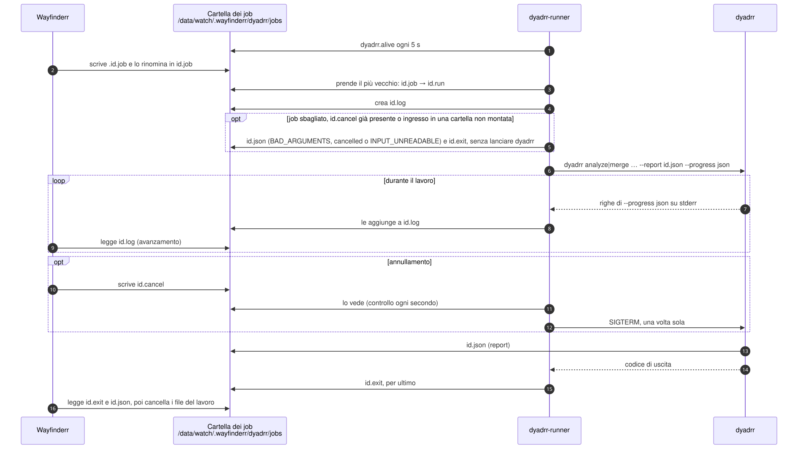

# Installazione

Tre modi di installare Dyadrr. Tutti danno gli stessi tre comandi:

| Comando | Cosa fa | Documentazione |
|---|---|---|
| `dyadrr` | Analisi e merge di una coppia | [CLI.md](CLI.md) |
| `dyadrr-runner` | Il runner dei file job, per Wayfinderr | [CONTAINER.md](CONTAINER.md) |
| `dyadrr-pairs` | Analisi di un elenco di coppie, con un riassunto per la taratura | [COPPIE.md](COPPIE.md) |

Negli esempi i rip stanno in `/media/film` e i nomi dei film sono inventati.

## Requisiti

| Programma | Versione | Perché | Controllo |
|---|---|---|---|
| Node | 22 | Dyadrr è TypeScript compilato | `node --version` |
| mkvtoolnix | almeno v57 | `mkvmerge` legge le tracce e unisce i file; `mkvinfo` e `mkvpropedit` servono ai test | `mkvmerge --version` |
| ffmpeg e ffprobe | almeno 6.1 | Legge le finestre audio per la misura; nel merge solo i punti di taglio e la coda delle tracce FLAC, sempre senza ricodificare | `ffmpeg -version` |

Una versione troppo vecchia o mancante è un errore con il suo codice
(`TOOL_TOO_OLD`, `TOOL_MISSING`, uscita 30), prima di leggere i file. Il
metodo di lettura dell'audio è provato su ffmpeg 6.1 (studio §13, §14.2):
l'immagine Docker usa la 6.1.2. Nessuna scheda grafica: il video non viene mai
decodificato.

## Docker

L'immagine `ghcr.io/tehmaat/dyadrr` ha già Node, ffmpeg 6.1.2, mkvtoolnix 92.0
e i tre comandi, per amd64 e arm64. È il modo più semplice.

```bash
docker pull ghcr.io/tehmaat/dyadrr
```

| Tag | Cosa è |
|---|---|
| `latest` | L'ultimo commit di `main` |
| `<versione>`, per esempio `0.24.0` | Una versione, dalle [release](https://github.com/TehMaat/dyadrr/releases) |
| `sha-<7 caratteri>` | Un commit di `main` |

Per un uso stabile conviene fissare la versione. Il comando di default è il
runner; per la riga di comando si scrive `dyadrr` dopo l'immagine. La cartella
di lavoro nel container è `/data`: si monta lì la cartella dei rip e si usano
percorsi relativi.

```bash
docker run --rm -v /media/film:/data/film ghcr.io/tehmaat/dyadrr:latest \
  dyadrr analyze "film/Faro di Velmora (2011) [BD ITA].mkv" "film/Faro di Velmora (2011) [UHD].mkv" \
  --report film/analisi.json
```

Con le [variabili d'ambiente](#variabili-della-riga-di-comando) e con
l'utente del proprio sistema, perché i file scritti non siano di root:

```bash
docker run --rm --user "$(id -u):$(id -g)" -e DYADRR_TAIL=trim -e DYADRR_INPUTS=keep \
  -v /media/film:/data/film ghcr.io/tehmaat/dyadrr:latest \
  dyadrr merge "film/Faro di Velmora (2011) [BD ITA].mkv" "film/Faro di Velmora (2011) [UHD].mkv" \
  --output "film/Faro di Velmora (2011).mkv" --expect film/analisi.json
```

Comodo come alias:

```bash
alias dyadrr='docker run --rm --user "$(id -u):$(id -g)" -v "$PWD":/data/film -w /data/film ghcr.io/tehmaat/dyadrr:latest dyadrr'
```

## Docker Compose con Wayfinderr

In Wayfinderr Dyadrr gira come servizio separato: Wayfinderr scrive i lavori
come file job in una cartella condivisa e il runner li esegue uno alla volta
([CONTAINER.md](CONTAINER.md)).

<picture>
  <source media="(prefers-color-scheme: dark)" srcset="img/diagrams/wayfinderr-dark.svg">
  
</picture>

Il servizio nel `docker-compose.yml` di Wayfinderr (dalla 0.19.0 di
Wayfinderr), nel profilo `merge`:

```yaml
  dyadrr:
    image: ghcr.io/tehmaat/dyadrr:${DYADRR_TAG:-latest}
    profiles: ["merge"]
    hostname: dyadrr
    stop_grace_period: 30s
    restart: unless-stopped
    volumes:
      - ${MAKEMKV_OUTPUT_DIR:-./makemkv-output}:/data/watch
      - ${DOWNLOADS_DIR:-./downloads}:/data/downloads:ro
      - ${SEEDING_DIR:-./seeding}:/data/seeding:ro
```

```bash
docker compose --profile merge up -d dyadrr
```

Per controllare che giri: il runner riscrive `dyadrr.alive` ogni 5 secondi
nella cartella dei job, e le sue righe sono in `docker compose logs dyadrr` e
in `dyadrr.runner.jsonl`. La seconda riga dice le cartelle montate, per
esempio `mounted: watch (rw), downloads (ro), seeding (ro)`: ogni cartella da
cui Wayfinderr passa i file deve esserci ([FAQ](FAQ.md)).

### Variabili del Compose

Si mettono nel file `.env` accanto al Compose.

| Variabile | Default | Cosa decide |
|---|---|---|
| `DYADRR_TAG` | `latest` | Il tag dell'immagine: una versione per restare fermi |
| `MAKEMKV_OUTPUT_DIR` | `./makemkv-output` | La cartella sorvegliata di Wayfinderr, montata in scrittura su `/data/watch`: rip trattenuti, file finali, job |
| `DOWNLOADS_DIR` | `./downloads` | I download, montati in sola lettura su `/data/downloads` |
| `SEEDING_DIR` | `./seeding` | I film pubblicati in locale, dove sono in seeding, montati in sola lettura su `/data/seeding` (TehMaat/wayfinderr#86) |

Le scelte del merge e i rip dopo il merge li passa Wayfinderr in ogni file
job, dalle sue impostazioni: le variabili `DYADRR_*` della riga di comando non
servono nel Compose.

## Da sorgente

Per sviluppare, o per usare Dyadrr senza Docker. Servono i
[requisiti](#requisiti), per esempio su Debian e Ubuntu:

```bash
sudo apt-get install ffmpeg mkvtoolnix
```

Su macOS con Homebrew:

```bash
brew install node@22 ffmpeg mkvtoolnix
```

Poi:

```bash
git clone https://github.com/TehMaat/dyadrr.git && cd dyadrr
```

```bash
npm ci && npm run build
```

```bash
npm link    # mette dyadrr, dyadrr-runner e dyadrr-pairs nel PATH
```

Senza `npm link` si lancia `node dist/bin.js` (e `dist/runner-bin.js`,
`dist/pairs-bin.js`). Per controllare l'installazione:

```bash
dyadrr --version && mkvmerge --version && ffmpeg -version | head -n 1
```

## Variabili della riga di comando

Preimpostano le scelte del merge e cosa fare dei rip dopo; un'opzione sulla
riga di comando vince sempre. Sono le stesse con Docker (`-e`) e da sorgente
(`export`).

| Variabile | Opzione | Valori |
|---|---|---|
| `DYADRR_TAIL` | `--tail` | `trim`, `keep` |
| `DYADRR_ITALIAN` | `--italian` | `all`, `main` |
| `DYADRR_REFERENCE_ITALIAN_SUBS` | `--reference-italian-subs` | `keep`, `drop` |
| `DYADRR_EDGE_MISMATCH` | `--edge-mismatch` | `drop`, `keep` |
| `DYADRR_INPUTS` | `--inputs` | `keep`, `delete` |

Il significato di ogni valore è in [CLI.md](CLI.md#scelte) e
[CLI.md](CLI.md#ingressi-dopo-il-merge).

## Aggiornare

- **Docker:** `docker pull ghcr.io/tehmaat/dyadrr:<versione>`, oppure il nuovo
  `DYADRR_TAG` e `docker compose --profile merge up -d dyadrr`.
- **Da sorgente:** `git pull && npm ci && npm run build`; con `npm link` i
  comandi puntano già alla nuova build.

Prima di aggiornare conviene leggere il [CHANGELOG](CHANGELOG.md): una
versione che cambia l'analisi rende superati i report vecchi per
`merge --expect` e per `dyadrr-pairs` ([COPPIE.md](COPPIE.md#report-importati)).

## Disinstallare

- **Docker:** `docker image rm ghcr.io/tehmaat/dyadrr:<versione>`; nel Compose
  si toglie il servizio `dyadrr`.
- **Da sorgente:** `npm unlink -g dyadrr` e si cancella la cartella del
  repository.

Dyadrr non lascia niente fuori dalle cartelle dei file: i temporanei di un
merge stanno in `.dyadrr/` accanto al file finale e si tolgono alla fine.
