# Workflow

I workflow di GitHub Actions in `.github/workflows/`, e gli script che
tengono aggiornate la documentazione e i branch.

<picture>
  <source media="(prefers-color-scheme: dark)" srcset="img/diagrams/workflow-dark.svg">
  
</picture>

| Workflow | File | Quando | Cosa fa |
|---|---|---|---|
| **CI** | `ci.yml` | Ogni PR e ogni push su `main` | `npm test` e `npm run build` su Ubuntu 24.04 con ffmpeg e mkvtoolnix; rigenera le [schermate](#schermate) e fallisce se sono diverse da quelle nel repository. Nelle PR controlla anche versione e CHANGELOG (`npm run check:version`) |
| **Image** | `image.yml` | Ogni PR e ogni push su `main` | Costruisce l'immagine Docker per amd64 e arm64, ci ripete la suite, controlla le versioni, prova il runner e `dyadrr-pairs`; su `main` la pubblica su GHCR ([CONTAINER.md](CONTAINER.md#immagine)) |
| **Release** | `release.yml` | Ogni push su `main` | Se la versione di `package.json` non ha ancora un tag, crea `vX.Y.Z` e la release con le note del CHANGELOG |
| **Branch cleanup** | `branch-cleanup.yml` | PR chiusa, ogni lunedì, a mano | Cancella i branch secondo le [regole](#pulizia-dei-branch) |

## Pulizia dei branch

Ogni sessione di lavoro apre un branch; senza pulizia restano tutti. Il
workflow **Branch cleanup** li cancella con regole fisse, scritte in
`scripts/branch-cleanup.mjs` (funzione `decide`, provata da
`test/branch-cleanup.test.ts`), con i numeri e le eccezioni in
`.github/branch-cleanup.json`.

<picture>
  <source media="(prefers-color-scheme: dark)" srcset="img/diagrams/branch-cleanup-dark.svg">
  
</picture>

**Non si cancella mai:** il branch di default, un branch protetto, un branch
in `keep` o con un prefisso di `keepPrefixes` (oggi `keep/` e `release/`), un
branch con una PR aperta, anche draft.

**Si cancella**, nell'ordine:

| Regola | Quando | Configurazione |
|---|---|---|
| `merged` | L'ultima PR del branch è mergiata e sul branch non ci sono commit dopo | — |
| `in-default` | L'ultimo commit del branch è già contenuto nel branch di default | — |
| `closed` | L'ultima PR è chiusa senza merge da più di N giorni, senza commit dopo | `closedUnmergedDays`: 14 |
| `stale` | Nessuna PR e ultimo commit di più di N giorni fa | `staleDays`: 30 |

Un branch con commit dopo il merge della sua PR si tiene (`new-commits`): è
lavoro nuovo, non ancora in una PR.

**Quando gira:**

- **PR chiusa:** se è mergiata e il branch è di questo repository, solo quel
  branch. È il caso normale: dopo il merge il branch sparisce.
- **Ogni lunedì** alle 04:17 UTC: tutti i branch.
- **A mano** (*Actions → Branch cleanup → Run workflow*): tutti i branch, per
  default come **prova a vuoto** (`dry-run`), che elenca cosa cancellerebbe
  senza cancellare. Il riepilogo, branch per branch con la regola, è nel
  *summary* del job.

In *Settings → General → Pull Requests* conviene anche attivare
**Automatically delete head branches**: GitHub cancella il branch al merge,
e il workflow resta per gli altri casi.

## Documentazione sempre aggiornata

La documentazione descrive sempre il codice di `main`
([CONTRIBUTING.md](../CONTRIBUTING.md#documentazione)). Oltre alle tabelle
confrontate con il codice, `npm test` (`test/docs.test.ts`) controlla:

- **Diagrammi:** ogni `docs/diagrams/<nome>.mmd` ha `docs/img/diagrams/<nome>.svg`
  e `<nome>-dark.svg` generati da quel sorgente (lo SHA-256 del sorgente è in
  testa all'SVG), e ogni immagine è usata in un documento;
- **Immagini e link:** ogni immagine e ogni link relativo dei documenti porta a
  un file che esiste, e ogni `#ancora` a un titolo che esiste;
- **Niente diagrammi ASCII:** nei `.md` non ci sono i caratteri per disegnare
  riquadri (Unicode da U+2500 a U+257F): i diagrammi sono immagini;
- **Variabili:** la tabella delle variabili del [README](../README.md#variabili-dambiente)
  elenca esattamente le variabili `DYADRR_*` del codice, e nei documenti non
  compaiono variabili che non esistono;
- **Full Vibe Coded:** la dicitura è nel README e nell'indice dei documenti;
- **Nomi inventati:** nei documenti, nei sorgenti e nei test non tornano i
  titoli veri dei film delle prove né percorsi personali
  ([README.md](README.md#nomi)).

### Diagrammi

I sorgenti sono in `docs/diagrams/`, in [Mermaid](https://mermaid.js.org); le
immagini in `docs/img/diagrams/`, una per il tema chiaro e una per quello
scuro, mostrate con `<picture>`:

```html
<picture>
  <source media="(prefers-color-scheme: dark)" srcset="img/diagrams/flusso-dark.svg">
  
</picture>
```

Dopo aver cambiato o aggiunto un `.mmd`:

```bash
npm run docs:diagrams
```

Usa `@mermaid-js/mermaid-cli` con npx (la versione è fissata nello script) e
un Chromium: quello di Puppeteer, uno di sistema o `CHROME_PATH`. Rigenera
solo i diagrammi cambiati; `-- --all` li rigenera tutti, `-- --check`
controlla soltanto.

### Schermate

Le schermate del terminale in `docs/img/screens/` le genera
`scripts/docs-screens.mjs`: crea due film sintetici con nomi inventati (rumore
rosa in 5.1 e un video di prova, come i test), lancia i veri `dyadrr` e
`dyadrr-pairs` e salva comandi e uscite come SVG. Ore, durate e cartelle
temporanee si normalizzano, così l'uscita è la stessa a ogni esecuzione.

```bash
npm run build && npm run docs:screens
```

Servono ffmpeg e mkvtoolnix, come per i test. La CI le rigenera e fallisce se
sono diverse: una PR che cambia l'uscita della riga di comando, il report o
`dyadrr-pairs` le rigenera e le committa.
